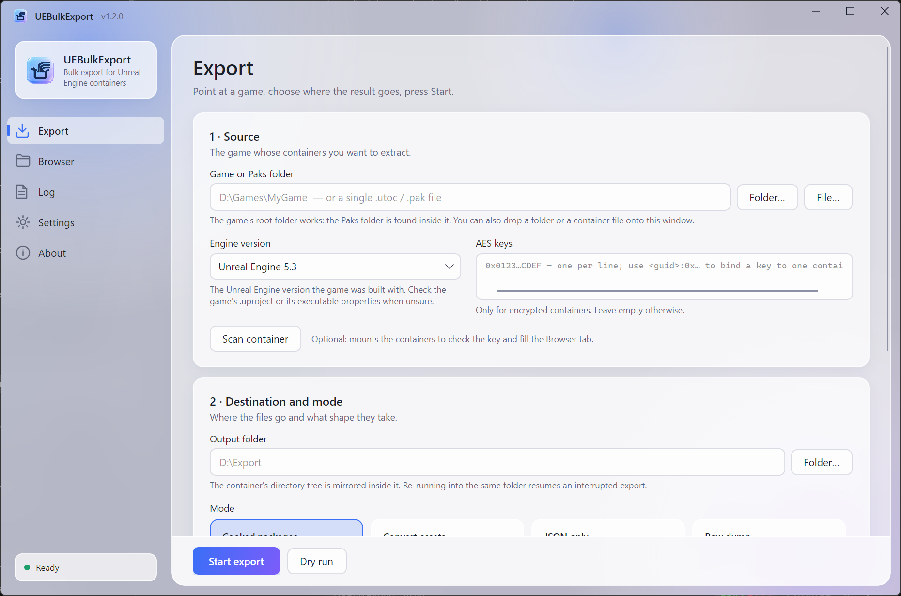
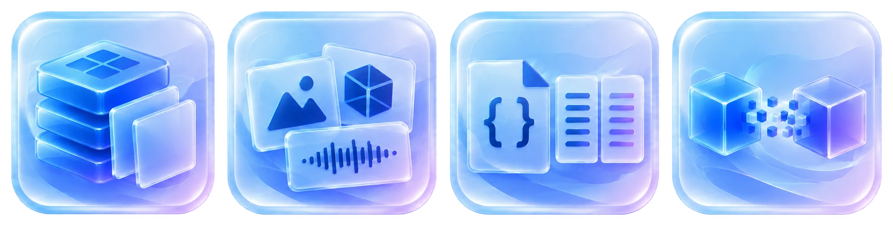

<div align="center">

<picture>
  <source media="(prefers-color-scheme: dark)" srcset="docs/images/logo-dark.png">
  
</picture>

**Просмотр и выгрузка контейнеров Unreal Engine в настольном приложении.**

[](LICENSE)
[](https://dotnet.microsoft.com/download)
[](https://github.com/FabianFG/CUE4Parse)
[](https://github.com/tavridabless/UEBulkExport/actions/workflows/ci.yml)
[](https://github.com/tavridabless/UEBulkExport/releases)

[English](README.md) · [Плагины](docs/plugins.ru.md) · [Про маппинги](docs/mappings.ru.md) · [Сторонние компоненты](THIRD-PARTY-NOTICES.md)

</div>

<p align="center">
  
</p>

---

## Что это

UEBulkExport — настольное приложение для Windows, которое показывает содержимое cooked-контейнеров
Unreal Engine (`.pak`, `.utoc` и `.ucas`) и выгружает их целиком. Оно умеет извлекать
cooked-пакеты, конвертировать поддерживаемые ассеты в распространённые форматы, выгружать
сериализованные свойства в JSON или делать побайтовую копию записей контейнера. Дерево каталогов
при этом сохраняется.

Результат по умолчанию, **Игровые пакеты** (режим `legacy`), извлекает `.uasset`/`.umap` вместе со связанными
`.uexp`/`.ubulk`/`.uptnl` и не создаёт JSON. Пакеты IoStore переводятся из формата Zen в обычный
cooked-формат с помощью [retoc](https://github.com/trumank/retoc). Если нужны конвертированные
файлы или данные свойств, выберите **Готовые файлы** (`full`) или **Данные для сравнения** (`json`).

### На чём это построено

**Чтение контейнеров и конвертация ассетов выполняются библиотеками
[CUE4Parse](https://github.com/FabianFG/CUE4Parse) и CUE4Parse-Conversion.** Перевод IoStore в
обычные cooked-пакеты выполняет [retoc](https://github.com/trumank/retoc). CUE4Parse и
CUE4Parse-Conversion распространяются по Apache-2.0, retoc — по MIT.

UEBulkExport отвечает за работу в окне и оркестровку вокруг этих библиотек: поиск путей,
сканирование контейнеров, выбор и фильтрацию, планирование работы, многопроходный экспорт,
возобновляемые прогоны, отображение прогресса и диагностику. Настольное приложение и
необязательная консольная версия используют одно ядро, а в [списке компонентов](THIRD-PARTY-NOTICES.md)
расписано, что чьё.

**Это не восстановление исходных ассетов редактора.** При cooking удаляются данные, нужные для
редактирования. Unreal Editor открывает лишь некоторые типы cooked-ассетов, обычно только для
чтения, если разрешить cooked-контент в проекте. Исходные графы Blueprint так не восстановить.
Явный режим `json` по-прежнему выгружает сериализованные свойства.

---

## Настольный интерфейс

`UEBulkExport.exe` — настольное приложение на [Avalonia](https://avaloniaui.net/) (MIT). Это
основной способ работы с инструментом: установите релиз, запустите UEBulkExport и настройте
экспорт, не набирая команд.



Страницы:

- **Экспорт** — укажите игру, и окно само её прочитает: найдёт контейнеры, определит версию движка
  по исполняемому файлу игры, сообщит о зашифрованных контейнерах (и только тогда попросит
  AES-ключ) и поищет файл маппингов. Вы выбираете, что нужно получить и куда сохранить. Фильтры,
  форматы, число потоков, вспомогательные программы и эквивалентная команда спрятаны в свёрнутые
  разделы, которые показывают своё состояние, например *«Рекомендуемые настройки»*. Панель внизу
  сообщает, готов ли экспорт к запуску, а если нет — почему; **«Пробный запуск»** показывает план.
  Во время работы видны скорость и оставшееся время, по окончании — сводка и кнопки для открытия
  папки вывода, журнала и `errors.csv`. Кнопка «Выбрать файлы с ошибками» помогает повторить
  экспорт этих файлов с изменёнными настройками. Недавние игры доступны в один клик.
- **Производительность** — пока идёт экспорт или перенос, панель на его странице посекундно
  показывает скорость чтения и записи диска, загрузку процессора, памяти и видеокарты всего
  компьютера и называет, что тормозит работу (например, *Упор в диск · занят на 96 %*). Наведите
  курсор на график, чтобы увидеть показания в любой момент; после завершения история остаётся.
- **Перенос в UE** — восстанавливает ассеты из cooked-дампа UE4 в вашем проекте Unreal; см.
  [Перенос ассетов на другую версию движка](#перенос-ассетов-на-другую-версию-движка).
- **Плагины** — находит manifest расширений без выполнения их DLL, показывает иконку, описание и
  совместимость и загружает только явно включённые плагины после перезапуска. Плагин может добавить
  собственную страницу навигации; см. [Desktop-плагины](docs/plugins.ru.md).
- **Обзор** — дерево папок смонтированных контейнеров, поиск и фильтр записей по типу, пути и
  размеры, выбор отдельных файлов или папок, экспорт только выбранного или добавление его в список
  исключений. Контейнеры с неверным или отсутствующим ключом AES помечаются как заблокированные.
  Большие папки показываются страницами по 5000 строк, с общим числом совпадений и кнопками
  «Назад» / «Далее». Отметки сохраняются при смене страниц и фильтров до смены источника.
  Чтобы открыть папку, выделите её строку и нажмите Enter или кнопку «Открыть папку» в панели
  сведений.
  «Проверить экспорт» переносит выбор и исключения на страницу экспорта, где можно проверить
  режим, папку назначения и выполнить пробный запуск. Быстрый экспорт доступен отдельно.
- **Журнал** — всё, что сообщает экспортёр, с фильтром по уровню, копированием, очисткой и
  автопрокруткой («Следить»).
  В окне хранятся последние 20 000 записей; старые строки и ожидающая обновления очередь ограничены,
  а файловый журнал экспорта не сокращается. Режим «Следить» показывает последние строки и при
  открытии страницы, и при включении флажка.
- **Настройки** — язык (английский / русский; после изменения появляется напоминание о
  перезапуске), тема (светлая / тёмная / как в системе), запоминание последних путей,
  подтверждение закрытия во время экспорта, число потоков по умолчанию, системные уведомления,
  пути к вспомогательным программам по умолчанию, сброс.
- **О программе** — версия, зависимости, лицензия, ссылки на документацию и проект.

В разделе **«Командная строка»** страницы «Экспорт» показана эквивалентная команда для текущих
настроек. Скопируйте её, если хотите повторить ту же задачу скриптом через `UEBulkExport.Cli.exe`.

Если перетащить на окно папку игры или файл `.utoc`/`.pak`, источник заполнится сам; если
перетащить `.uproject`, откроется «Перенос в UE» с этим проектом в качестве целевого. После
установки программа открывается на языке, выбранном в установщике (иначе на английском), со
светлой темой; и то и другое меняется на странице «Настройки» и запоминается. Настройки хранятся для каждого пользователя в
`%LOCALAPPDATA%\UEBulkExport\settings.json`; ничего не отправляется наружу. Если окно не смогло
запуститься, исключение записывается в `%LOCALAPPDATA%\UEBulkExport\crash.log`.

В Windows программа показывает системное уведомление, когда экспорт, пробный запуск или перенос
завершён, остановлен, закончился ошибкой либо ждёт решения пользователя. Щелчок по уведомлению
восстанавливает окно UEBulkExport и открывает нужную страницу. Ошибки отдельных файлов
объединяются в одно итоговое уведомление; функцию можно отключить в **«Настройках»**.
Там же находится кнопка **«Проверить уведомление»**. В Windows 10/11 используется настоящее
toast-уведомление, которое сохраняется в Центре уведомлений; старый системный трей остаётся
резервным способом для portable-запуска и старых сборок Windows.

Для скриптов и CI используйте `UEBulkExport.Cli.exe`. Исполняемый файл с окном тоже принимает
аргументы командной строки для совместимости, но как приложение с GUI-подсистемой Windows он не
блокирует интерактивную оболочку и не возвращает в неё код завершения надёжно.

---

## Управление рабочим процессом

На странице экспорта рядом находятся источник, режим и папка результата. Рецепты открываются
из отдельного меню, а форматы, фильтры, пути вспомогательных программ и команда CLI находятся
в «Дополнительных параметрах». Если режим «Игровые пакеты» требует целый контейнер IoStore,
кнопка «Выбрать „Точную копию“» переключает режим и сохраняет выбор файлов.

В режиме **Full** «Контрольный экспорт» конвертирует несколько текстур, сеток, анимаций,
звуков, уровней или материалов. Отдельный отчёт показывает по каждому типу запрошенное
количество, число кандидатов, успешные конвертации, результаты без файлов и ошибки. Поиск
продолжается после пустого результата в пределах лимита пакетов. CLI возвращает код 2 при
неполном покрытии, ошибке чтения или конвертации. Успешные результаты сохраняются.

На странице «Сравнение» видны добавленные, удалённые и изменившиеся пакеты и файлы.
Быстрая проверка сопоставляет пути и размеры. SHA-256 выявляет правки без изменения размера.
Для пакета видны файлы, которые изменились. Отметки сохраняются при фильтрации по пути и типу
изменения. Если новая сборка выбрана как папка и её пути однозначны, можно подготовить полный
набор доступных файлов выбранного пакета. При неоднозначной структуре файлы показываются отдельно.

«Сохранить список изменений» записывает выбранные изменения и отпечатки обеих сборок.
На другом компьютере откройте манифест, укажите локальные источники и отдельно введите ключи
AES для каждой сборки. После проверки добавления и изменения можно выгрузить из новой сборки.
Удалённые группы отображаются в списке для сверки.

Кнопки «Сохранить рецепт» и «Открыть рецепт» сохраняют форматы, фильтры, версию движка
и при необходимости выбранные виртуальные пути. После открытия рецепта задайте локальные
пути и при необходимости введите ключи AES на странице экспорта.

В «Обзоре» можно включить поиск во всех подпапках по имени или виртуальному пути. Нажатие на
заголовок «Имя», «Тип» или «Размер» меняет сортировку. «Отметить страницу» и «Отметить все
совпадения» — разные действия; выбор сохраняется между страницами. Общий размер совпадений
взят из метаданных источника, а не из размера будущего результата конвертации.

Профили ресурсов меняют только потоки и бюджет raw-данных. В raw-режиме `--max-inflight-mb <MiB>`
(по умолчанию 256; 0 отключает) ограничивает одновременные чтения по известным размерам исходных
файлов. Файлы больше лимита или неизвестного размера читаются по одному. Это не лимит всей RAM;
больше потоков не гарантирует ускорение. Форматы, надёжная запись и совместимость журнала не меняются.

После отменённого или неуспешного экспорта «Продолжить предыдущий экспорт» использует сохранённый
запрос и выбор файлов, а не текущую форму, с включённым продолжением по журналу. Запрос доступен
только в этой сессии приложения. Источник и автоматически найденные зависимости должны оставаться
неизменными: обнаружение выполняется заново. «Пробный запуск» с выбором из «Обзора» больше не
создаёт папку вывода или `_selection.txt`.

«Проверить план миграции» читает метаданные источника и описание `.uproject`, не запуская Unreal
Editor или конвертеры, не создавая рабочие папки и не сохраняя ассеты. Проверка показывает неполные
payload-файлы, отсутствующие инструменты, требования Python-плагина и ограничения cooked-контента.
Успешная проверка условий не доказывает работоспособность конвертации или конкретной версии движка.
Для проверки самой миграции по-прежнему нужны подходящие cooked-ассеты и целевой редактор.
При наличии журнала импорта повторный перенос сообщает, какие исходники изменились.
«Заменять изменившиеся ассеты» обновляет их, сохраняя неизменившиеся результаты.

## Предварительная версия восстановления Blueprint и C#

Страница «Блюпринты» и команда `blueprint` читают сгенерированные классы, сохранившиеся в
cooked-пакетах. В отчёте видны родительские классы, доступные переменные и значения по умолчанию,
сигнатуры функций, инструкции Kismet и определяемые переходы. Лимиты и отсутствующие данные
отмечаются в отчёте. CLI возвращает код 2 при пустом или неполном анализе.

Команда `blueprint dump` восстанавливает поддерживаемые классы за один проход. Она создаёт
отдельный проект UE 5.8 с редактируемыми Blueprint в `/Game/RecoveredBlueprints`, карту связей и
отчёт о покрытии. Команда переносит нужные StaticMesh из `/Game`, включая меши из переопределений
компонентов. Новые ассеты сохраняют исходные пути, сокеты, читаемые последовательные LOD и
поддерживаемые формы простой коллизии. Общие материалы и текстуры импортируются один раз.
Редактор собирает редактируемые материалы из распознанных параметров cooked-кэша материалов и
переопределений экземпляров, а также декодирует связанные Texture2D. Ссылки `/Engine` разрешаются
в установленном редакторе.
`mesh-imports.json` перечисляет пропуски. Доступность исходных графов материалов, сложной коллизии
и удалённых LOD ограничена содержимым cooked-сборки.
Параметр `--managed-dir` позволяет искать оригинальные исходники C# в Portable
PDB, связанных с локальными управляемыми сборками.
Параметр `--decompile-csharp` создаёт проекты C# для сборок без извлечённых оригиналов.

```bat
UEBulkExport.Cli blueprint dump --out "D:\Recovery" --editor "C:\UE_5.8\Engine\Binaries\Win64\UnrealEditor-Cmd.exe" --managed-dir "D:\Build\Binaries\Managed" --paks "D:\Build\Paks" --game 5.8
```

Результат сохраняется в новой папке `recovery-…`. После создания ассетов откройте
`Project\RecoveredProject.uproject`. В `recovery-result.json` записаны пути к созданным файлам.
Код 2 означает, что результат сохранён с пропусками, например с заглушками или без части исходников.
CLI проверяет до 2000 пакетов и 100 000 инструкций. Отчёт показывает, если достигнут лимит.
В приложении выберите «Блюпринты → Связи → Восстановление → Восстановить в новом проекте UE»,
чтобы перенести подходящие классы из текущего анализа. Через `--batch-plan` или то же меню
можно сохранить план без запуска редактора.

```bat
UEBulkExport.Cli blueprint --report blueprint.json --dependency-map links.json --linked-plan plan.json --class "/Game/BP_Example.BP_Example_C" --paks "D:\Build\Paks" --game 5.8 --include "/(BP_Example|BFL_Example)[.]uasset$"
UEBulkExport.Cli blueprint restore --plan plan.json --editor "C:\UE_5.8\Engine\Binaries\Win64\UnrealEditor-Cmd.exe" --project "D:\Recovery\Recovery.uproject"
```

Для `--class` используйте точный путь класса из вывода анализа. Вкладка «Связи» и карта
зависимостей в JSON показывают родительские классы, вызовы и прямые ссылки на типы. На карте
различаются просканированные, нативные, внешние и неразрешённые ссылки. В приложении можно
открыть связанный класс или показать косвенные связи между просканированными классами.

Перенос создаёт редактируемые Actor Blueprint и Blueprint Function Library в проекте UE 5.8
на Windows с Python Editor Script Plugin. Для поддерживаемых типов `int` и `bool` восстанавливаются
возврат константы или входного параметра, логическое ветвление с двумя константами и подтверждённые
вызовы чистых функций Blueprint Function Library, возвращающих свой единственный скалярный аргумент.
Связанный план также переносит подтверждённое чтение и запись скалярных полей экземпляра,
несколько пользовательских событий с типизированными скалярными параметрами и поддерживаемыми
присваиваниями, а также виртуальные вызовы чистых функций без аргументов через типизированный
вход Blueprint. Если редактор сам назначает имя узлу события, исходную точку вызова может
сохранить отдельная функция, передающая параметры в событие.

План восстанавливает локальные деревья SceneComponent и StaticMeshComponent у Actor Blueprint
с доступными относительными трансформациями, флагами видимости, ссылками на меши и поддерживаемыми
привязками к сокетам. Дочерний Actor Blueprint может унаследовать восстановленный
класс, переопределить подходящую чистую функцию и сохранить сериализованные значения унаследованных
скалярных полей и поддерживаемые переопределения шаблонов компонентов. План создаёт нужные классы
перед потомками и вызывающими. Включите их в анализ.

При восстановлении отдельного плана используются StaticMesh из целевого проекта Unreal Editor.
Для выбора меша по другому пути передайте `--mesh-map` в `blueprint restore` или `blueprint dump`.
Записи карты имеют приоритет перед автоматическим переносом. В них указываются полные пути
объектов Unreal.

```json
{
  "schemaVersion": 1,
  "meshes": {
    "/Game/Geometry/SM_Table.SM_Table": "/Game/Imported/SM_Table.SM_Table"
  }
}
```

Для привязки к сокету он должен присутствовать в выбранном StaticMesh. Для импортированных
вручную мешей используйте подготовленный проект в `blueprint restore --project ...`.
Для отдельного класса используйте `--plan`. Остальные поддерживаемые сигнатуры получают помеченные
заглушки. Отчёт перечисляет пропуски. Исходная раскладка, макросы, произвольные графы событий
и тела нативных функций за пределами этого формата. Используйте ассеты, которые имеете право
восстанавливать, и при необходимости передайте локальный ключ AES или файл mappings.

Команда `source` проверяет управляемую сборку C# и связанный Portable PDB. Файлы извлекаются
из встроенных исходников после сверки контрольных сумм и побайтно записываются в отдельную папку.
Команда показывает отсутствие исходников, если компилятор их не встроил.

```bat
UEBulkExport.Cli source --assembly "D:\Build\Binaries\Managed\MyGame.dll" --out "D:\Recovery"
```

Команда `source decompile` создаёт редактируемые `.cs` и проект SDK из управляемого IL через
ILSpy без PDB. Отчёт перечисляет ненайденные зависимости. Добавьте `--reference-dir`, если они
лежат в отдельных папках. Для сборки используйте SDK .NET 10 и пакет для целевой платформы
из отчёта. Декомпилированный текст приближает оригинал. Команда сохраняет файлы без
автоматической сборки или запуска.

```bat
UEBulkExport.Cli source decompile --assembly "D:\Build\Binaries\Managed\MyGame.dll" --reference-dir "D:\Build\Dependencies" --out "D:\Recovery"
```

## Что получается на выходе

<p align="center">
  
</p>

По умолчанию воспроизводится дерево пакетов контейнера: `.uasset` или `.umap` вместе со связанными
`.uexp`, `.ubulk` и `.uptnl`. `.usmap` не требуется. Из обычного `.pak` данные берутся напрямую;
пакеты IoStore retoc переводит в обычный cooked-формат. Оба пути не восстанавливают данные
редактора, удалённые при cooking.

В явном режиме `--mode full` выходят конвертированные файлы:

| Ассет | Результат |
|---|---|
| любой `.uasset` / `.umap` | `.json` со всеми свойствами всех объектов; вложенные объекты — в подпапке `<ИмяАссета>/` |
| `UTexture2D`, `UTextureCube`, `UTexture2DArray` | `.png` (либо `.tga` / `.jpeg` / `.webp`) |
| `UStaticMesh`, `USkeletalMesh` | `.glb` (либо ActorX `.psk`/`.pskx`, `.uemodel`, `.usda`) |
| `USkeleton` | `.pskx` — glTF не умеет хранить скелет отдельно |
| `UAnimSequence`, `UAnimMontage`, `UAnimComposite` | `.psa` (либо `.ueanim`, `.usda`) |
| `USoundWave`, `UAkMediaAssetData` | исходный поток (`.binka` / `.ogg` / `.wav`) плюс раскодированный `.wav`, если доступен vgmstream |
| `UWorld` (`.umap`) | `.usda` со всем графом сцены и мешами, на которые она ссылается |
| материалы | `.json`; с `--materials` — полноценный экспорт материала с текстурами |
| `.ini`, `.png`, `.ttf`, `.svg`, `.locres`, `.mp4`, … | копируются как есть |

---

## Быстрый старт

### 1. Установка

UEBulkExport работает на 64-битной Windows 10 версии 1607 и новее, Windows 11 и Windows Server 2012
и новее. Сборка самодостаточная, отдельно устанавливать .NET не нужно.

1. Скачайте последний `UEBulkExport-<версия>-win-x64-setup.exe` со страницы
   [Releases](https://github.com/tavridabless/UEBulkExport/releases). Рядом лежит `SHA256SUMS.txt`,
   по нему можно проверить загрузку: `Get-FileHash .\UEBulkExport-<версия>-win-x64-setup.exe`.
2. Запустите установщик и выберите режим:
   - **Для всех пользователей** (рекомендуется) — установка в `C:\Program Files\UEBulkExport`,
     нужны права администратора.
   - **Только для меня** — установка в `%LOCALAPPDATA%\Programs\UEBulkExport` без прав
     администратора.

   Установщик пока не подписан цифровой подписью, поэтому SmartScreen может показать окно
   «Система Windows защитила ваш компьютер»; нажмите **Подробнее**, затем **Выполнить в любом
   случае**.
3. Выберите язык установщика (английский или русский): программа будет запускаться на этом же
   языке, пока вы не смените его в настройках. Примите лицензию Apache-2.0.
4. Укажите папку и компоненты. Рекомендуется **Полная установка**: кроме самой программы она
   добавляет нативные модули экспорта, офлайн-документацию и помощник UE4SS для получения
   маппингов. **Только основное приложение** ставит только окно программы и консольную версию.
5. При желании создайте ярлык на рабочем столе и добавьте консольную программу в `PATH`, затем
   завершите установку; мастер может сразу запустить UEBulkExport.

В меню «Пуск» появятся два ярлыка: **UEBulkExport** открывает окно, **UEBulkExport CLI** — командную
строку со справкой консольной программы, в которой сразу можно вводить команды. С опцией `PATH`
команда `UEBulkExport.Cli` работает из любой консоли; иначе вызывайте её по полному пути, например
`"C:\Program Files\UEBulkExport\UEBulkExport.Cli.exe" --help`.

**Обновление.** Запустите установщик новой версии. Он узнает установленную копию и покажет
*Обновление: 2.0.0 → 2.1.0*: лицензия, папка, компоненты и ярлыки берутся из установленной
копии, файлы, которые новой версии больше не нужны, удаляются, а настройки сохраняются. Сначала
закройте UEBulkExport — если программа ещё открыта, установщик попросит об этом. Повторный запуск
той же версии переустанавливает её и позволяет изменить компоненты; файлы снятых компонентов
удаляются. Установщик более старой версии спрашивает подтверждение, прежде чем заменить новую
(для тихой установки нужен ключ `/ALLOWDOWNGRADE`).

**Удаление.** Параметры Windows → Приложения → Установленные приложения → UEBulkExport → Удалить. В
конце программа удаления спросит, стереть ли также настройки, список недавних игр и скачанные
вспомогательные библиотеки в `%LOCALAPPDATA%\UEBulkExport`; по умолчанию они сохраняются.

**Установка без участия пользователя.** Работают стандартные ключи Inno Setup, например
`UEBulkExport-<версия>-win-x64-setup.exe /VERYSILENT /ALLUSERS /TASKS="addtopath"`. `/CURRENTUSER`
ставит программу только для текущего пользователя, `/LOG="setup.log"` пишет журнал. Кроме того,
установщик всегда пишет журнал в `%TEMP%` (`Setup Log <дата>.txt`).

### 2. Запустить экспорт

Запустите **UEBulkExport** из меню «Пуск» и выберите папку игры (или её `Content\Paks`). Окно сразу
её прочитает и покажет, что нашло: число контейнеров и записей, версию движка и есть ли
шифрование. Выберите, что нужно получить и куда сохранить, затем нажмите **«Начать экспорт»**.
Содержимое видно на странице «Обзор», а **«Пробный запуск»** проверяет план, ничего не записывая.

Для автоматической выгрузки пакетов выполните:

```bat
UEBulkExport.Cli --paks "D:\Games\MyGame" --out "D:\Export"
```

`--paks` принимает корневую папку игры, `Content\Paks` или отдельный `.utoc`. `--dry-run` показывает
план без записи. На Windows x64 при первом преобразовании IoStore автоматически скачивается
проверенная версия retoc; свой исполняемый файл можно указать через `--retoc`. Полученные пакеты
остаются cooked. Требования и ограничения редактора описаны в
[документации Epic](https://dev.epicgames.com/documentation/unreal-engine/working-with-cooked-content-in-the-unreal-engine).

### Для конвертации или JSON: получить `.usmap`

Режимы `full` и `json` разбирают свойства. Shipping-сборки UE5 обычно хранят их **без имён**,
поэтому этим режимам нужен файл маппингов. Для извлечения пакетов он не нужен.

**В [docs/mappings.ru.md](docs/mappings.ru.md) написано, как его получить** — с UE4SS это занимает пару
минут. Укажите готовый `.usmap` в поле **«Маппинги»** на странице «Экспорт» (оно появляется, если
выбрать **«Готовые файлы»** или **«Данные для сравнения»**), передайте через
`--usmap` или положите рядом с контейнерами игры: там он найдётся автоматически.

Для конвертированных форматов добавьте `--mode full`, для дампов свойств — `--mode json`.

---

## Перенос ассетов на другую версию движка

<p align="center">
  
</p>

Страница **«Перенос в UE»** превращает распакованный cooked-дамп игры в обычные ассеты вашего проекта Unreal. Работа идёт в два
этапа:

1. Для UE4 [UE Viewer](https://www.gildor.org/en/projects/umodel), а для UE5 встроенный CUE4Parse
   выгружает из cooked-пакетов всё, что можно восстановить: меши в glTF, текстуры в PNG, звуки в
   аудиофайлы.
2. Выбранный `UnrealEditor-Cmd.exe` запускается без окна и импортирует эти файлы в указанный
   проект. Там они сохраняются как новые ассеты нужной версии движка.

Файлы, которые уже лежат в дампе в форматах glTF, GLB, FBX, OBJ, PNG, TGA, DDS, JPEG, BMP, EXR,
HDR, WAV, OGG или MP3, импортируются сразу, без первого этапа.

**Что понадобится**

- Windows. Функция есть только в настольном приложении; в программе командной строки её нет.
- Распакованный cooked-дамп **UE 4.0–4.27 или UE 5.0–5.8**: папка с файлами `.uasset` и их данными, например
  результат экспорта **«Игровые пакеты»**.
- Для UE4 — UE Viewer (`umodel_64.exe`). Для UE5 файл маппингов `.usmap` необязателен, но заметно
  повышает шанс прочитать все ассеты; если он выбран, берите файл от той же сборки игры, что и
  дамп. Для обоих путей нужен установленный Unreal Editor. UEBulkExport не
  скачивает UE Viewer и Unreal Editor.
- Целевой `.uproject` с включённым плагином **Python Editor Script Plugin** (*Edit → Plugins*).
  Импорт в редакторе выполняется через Python.

**Как запустить**

1. Укажите папку дампа и точную версию движка, на которой он собран. Для UE5 можно оставить поле
   `.usmap` пустым и запустить перенос; если часть ассетов не читается, получите `.usmap` от этой
   же сборки и выберите его в разделе **«Инструменты»**.
2. Выберите целевой `.uproject` или нажмите **«Подобрать»**: если поле пустое, программа предложит
   недавно использованный проект. UE Viewer и подходящий `UnrealEditor-Cmd.exe` находятся
   автоматически; раздел **«Инструменты»** показывает, что найдено, и сам раскрывается, если чего-то
   не хватает. Введённые вами пути никогда не заменяются, а при запуске программы проект сам не
   выбирается.
3. Проверьте папку контента — путь внутри `/Game`, например `/Game/Migrated`. Панель внизу страницы
   подскажет, чего ещё не хватает.
4. Нажмите **«Начать перенос»**. Прежде чем что-либо записать в проект, программа покажет окно
   подтверждения с проектом и папкой контента.

Если UE Viewer падает на каком-то пакете, в окне появятся текст ошибки и кнопка
**«Пропустить файл и продолжить»**.
Продолжение пропускает этот пакет и идёт дальше; в конце все пропущенные и неимпортированные файлы
попадают в `conversion-errors.csv`. Пакеты с пустыми `.uexp` или `.ubulk` пропускаются ещё до
начала выгрузки. Если программа долго ничего не выводит (UE Viewer — 15 минут, редактор —
30 минут), она закрывается, чтобы зависший процесс не блокировал работу.

**Ваши файлы в безопасности**

- Исходный дамп только читается. Пакеты, которые нужно пропустить, просто не попадают во временную
  рабочую копию из жёстких ссылок (на другом диске — из обычных копий); сам дамп никогда не
  переименовывается, не перемещается и не меняется. Рабочая копия удаляется по окончании.
- Пока выключен пункт **«Заменять существующие ассеты»** (по умолчанию), повторный запуск не трогает
  ассеты, которые уже есть в проекте, и показывает их как *«Уже есть в проекте»*, а не как ошибки.
  Так же можно продолжить прерванный перенос. Включайте пункт, только если нужно импортировать всё
  заново.

**Логи и промежуточные файлы** хранятся в целевом проекте, в отдельной папке для каждого дампа:
`<проект>\Saved\UEBulkExport\DumpConversion\<дамп>_<версия>_<id>\`. В ней лежат:

| Файл | Содержимое |
|---|---|
| `Exported\` | Файлы, выгруженные UE Viewer (UE4) или CUE4Parse (UE5) |
| `umodel.log` | Вывод UE Viewer |
| `unreal-import.log` | Вывод Unreal Editor, включая ошибки Python |
| `conversion-errors.csv` | Пропущенные и неимпортированные файлы с причиной |
| `import-ledger.json` | Какой исходный файл дал какой ассет; нужен при повторных запусках |

**Ограничения.** Перенос восстанавливает ассеты из cooked-данных, это не «анкукер». Восстановить
можно меши, текстуры и поддерживаемый звук. Блюпринты, материалы, уровни, системы Niagara и другие
данные, нужные только редактору, были удалены при сборке игры и не восстанавливаются. Анимации
ActorX (`.psa`, `.psk`) попадают в отчёт, но не импортируются: Unreal Engine 5 не
читает их сам. Переносите только те ассеты, на использование которых у вас есть права.

---

## Режимы

<p align="center">
  
</p>

| Режим | В окне | Маппинги | Что делает |
|---|---|---|---|
| `legacy` *(по умолчанию)* | Игровые пакеты | не нужны | Извлекает cooked `.uasset`/`.umap` со связанными файлами; IoStore переводит в обычный cooked-формат через retoc |
| `full` | Готовые файлы | нужны | Разбирает все пакеты и конвертирует в рабочие форматы |
| `json` | Данные для сравнения | нужны | Только дампы свойств — быстро, компактно, удобно для сравнения двух сборок |
| `raw` | Точная копия | не нужны | Побайтовый дамп всех записей контейнера |
| `list` | Страница «Обзор» | не нужны | Печатает содержимое контейнера и выходит |

> **Ограничение редактора:** `legacy` меняет структуру пакета, но не возвращает исходный ассет до
> cooking. Редактор открывает только поддерживаемые cooked-типы, обычно только для чтения, после
> разрешения cooked-контента. `raw` оставляет IoStore-пакеты в формате Zen; это не обычные пакеты
> для редактора.

Чтобы попробовать cooked-пакеты в проекте Unreal на Windows, используйте ту же версию движка,
на которой собрана игра (включая minor-версию), сохраните исходный путь `Content` и добавьте в
`Config/DefaultEngine.ini` проекта:

```ini
[/Script/UnrealEd.CookerSettings]
cook.AllowCookedDataInEditorBuilds=True
s.AllowUnversionedContentInEditor=1
```

Скопируйте пакет и все связанные файлы в соответствующий путь `Content`. Epic предупреждает, что
редакторы ассетов и многие классы не поддерживаются; пакет не становится редактируемым.


**Новые версии движка.** В retoc 0.1.5 можно явно указать версии Unreal Engine до UE5.7
включительно. Для UE5.8 и новее UEBulkExport поручает retoc определить версию по контейнерам.
На тестовом контейнере UE5.8 этот режим сработал. Совместимость зависит от контейнера. Если
конвертация не удалась, выберите **«Точную копию»** (`raw`) или **«Готовые файлы»** (`full`)
либо укажите совместимую сборку retoc во **«Вспомогательных программах»** (`--retoc`).

---

## Параметры

Полный и актуальный список — `UEBulkExport.Cli --help`. Каждый параметр ниже есть и на странице
экспорта в окне.

### Пути

| Параметр | Значение |
|---|---|
| `--paks <path>` | Папка Paks, любая папка выше неё или отдельный файл `.utoc` |
| `--out <dir>` | Куда складывать результат |
| `--usmap <file>` | Файл маппингов. Находится сам, если ровно один `.usmap` лежит рядом с исполняемым файлом, в текущем каталоге или рядом с контейнерами |

### Основные

| Параметр | Значение |
|---|---|
| `--mode legacy\|full\|json\|raw\|list` | См. [Режимы](#режимы) |
| `--game <version>` | Версия движка, по умолчанию `GAME_UE5_3`. Понимает `5.3`, `UE5_3`, `GAME_UE5_3` |
| `--aes 0x…` | Ключ AES для зашифрованных контейнеров. Можно повторять; `--aes <guid>:0x…` привязывает ключ к конкретному контейнеру |
| `--threads <n>` | Число потоков, по умолчанию «ядер минус одно» |
| `--max-inflight-mb <MiB>` | Бюджет одновременных чтений raw по метаданным, по умолчанию 256; 0 отключает; не лимит всей RAM |
| `--dry-run` | Показать план и ничего не записывать |
| `--retoc <file>` | Исполняемый файл retoc для преобразования IoStore; на Windows x64 скачивается автоматически |
| `--verbose` | Записывать в лог каждый записанный файл |
| `--version` | Напечатать версию и выйти |

### Фильтрация

| Параметр | Значение |
|---|---|
| `--include <regex>` | Только записи, чей путь в контейнере совпал; недоступно для IoStore в режиме `legacy` |
| `--exclude <regex>` | Пропустить записи, чей путь совпал; недоступно для IoStore в режиме `legacy` |
| `--paths-file <file>` | Экспортировать только записи из файла, по одному пути в контейнере на строку. Окно записывает `_selection.txt` для выбора галочками, так что экспорт из GUI можно повторить скриптом |

### Что записывать

| Параметр | Значение |
|---|---|
| `--no-json` | Не писать дампы свойств |
| `--no-assets` | Не конвертировать меши/текстуры/звук/анимации |
| `--no-raw-misc` | Не копировать обычные файлы вне пакетов |
| `--no-worlds` | Не выгружать уровни `.umap` |
| `--no-audio-convert` | Не делать `.wav` рядом с BINKA/ADPCM |
| `--raw-packages` | Дополнительно сохранять нетронутые байты `.uasset`/`.ubulk` |
| `--materials` | Экспортировать материалы как ассеты и тянуть в меши их материалы и текстуры |
| `--overwrite` | Переделать записи, уже отмеченные как готовые |

### Форматы

| Параметр | Значения |
|---|---|
| `--mesh` | `gltf2` *(по умолчанию)*, `actorx`, `ueformat`, `usd` |
| `--anim` | `actorx` *(по умолчанию)*, `ueformat`, `usd` |
| `--texture` | `png` *(по умолчанию)*, `tga`, `jpeg`, `webp` |
| `--quality` | `highest` *(по умолчанию)*, `lowest`, `all` — какие LOD'ы мешей писать |
| `--nanite` | `nonanite` *(по умолчанию)*, `naniteonly`, `nanitefirst`, `nanitelast` |
| `--sockets` | `bone` *(по умолчанию)*, `socket`, `none` |
| `--all-mips` | Писать все мипы текстур |
| `--no-morphs` | Пропускать морф-таргеты |
| `--platform` | `DesktopMobile` *(по умолчанию)*, `XboxAndPlaystation4`, `Playstation5`, `NintendoSwitch` |

### Вспомогательные библиотеки

| Параметр | Значение |
|---|---|
| `--oodle <file>` | Библиотека Oodle. Ищется сама, иначе скачивается |
| `--zlib <file>` | Библиотека zlib-ng. Так же |
| `--vgmstream <file>` | `vgmstream-cli` для конвертации BINKA/ADPCM в `.wav` |

### Коды завершения

`0` — успех. `1` — прогон не удалось начать (неверные аргументы, отсутствующие пути) или он
аварийно завершился. `2` — прогон закончился с ошибочными записями либо был отменён.

---

## Рецепты

**Только контент игры, без движковых ассетов и уровней** — обычная отправная точка, и заметно
быстрее, в режиме конвертации:

```bat
UEBulkExport.Cli --paks "D:\Games\MyGame" --out "D:\Export" --mode full --exclude "^Engine/" --no-worlds
```

**Только текстуры, в TGA:**

```bat
UEBulkExport.Cli --paks "D:\Games\MyGame" --out "D:\Textures" ^
             --mode full --no-raw-misc --include "/Textures?/" --texture tga
```

**Меши и скелеты под импортёр PSK/PSA в Blender:**

```bat
UEBulkExport.Cli --paks "D:\Games\MyGame" --out "D:\Meshes" --mode full --mesh actorx --no-json
```

**Проверить конвертацию текстур перед массовым экспортом**

```bat
UEBulkExport.Cli sample --type texture --per-type 2 --paks "D:\Games\MyGame" --out "D:\Checks"
```

**Сравнить две сборки с проверкой файлов одинакового размера**

```bat
UEBulkExport.Cli compare --before "D:\Games\MyGame-1.0" --after "D:\Games\MyGame-1.1" --hash --json
```

Добавьте `--groups --save-manifest "changes.json"`, чтобы сохранить сгруппированные
изменения. На другом компьютере можно проверить сборки и посмотреть план Raw-экспорта:

```bat
UEBulkExport.Cli compare --apply-manifest "changes.json" --before "D:\Builds\Old" --after "D:\Builds\New" --out "D:\Changes" --dry-run
```

Чтобы выполнить экспорт, запустите ту же команду без `--dry-run`.

**Сохранить переносимый рецепт и выполнить его с локальными путями**

```bat
UEBulkExport.Cli recipe save textures.json --mode full --include "/Textures?/" --texture tga
UEBulkExport.Cli recipe run textures.json --paks "D:\Games\MyGame" --out "D:\Textures"
```

Для зашифрованного источника передайте `--aes <ключ>` при вызове `recipe run`. У `compare`
для каждой сборки свои параметры `--before-aes <ключ>` и `--after-aes <ключ>`. Рецепт JSON
хранит переносимые параметры и виртуальные пути. Локальные пути, маппинги, инструменты и ключи
задаются при запуске.

**Зашифрованные контейнеры:**

```bat
UEBulkExport.Cli --paks "D:\Games\MyGame" --out "D:\Export" ^
             --aes 0x0123456789ABCDEF0123456789ABCDEF0123456789ABCDEF0123456789ABCDEF
```

---

## Возобновление, логи и ошибки

Каждая полностью обработанная запись дописывается в `_completed.<mode>.txt` в папке вывода.
Перед этим её файлы создаются во временной области, сбрасываются на диск и атомарно переносятся
на окончательные пути. Поэтому выключение компьютера не превращает обрезанный `.uasset`, `.uexp`,
`.ubulk` или конвертированный файл в готовый результат. Повторный запуск проверяет журнал, размеры
файлов, исходные контейнеры и настройки, сохраняет завершённое и повторяет только незавершённое.

IoStore в режиме `legacy` преобразуется retoc во временной области после обычных записей. При его
отмене уже завершённые обычные файлы сохраняются, а незавершённая фаза retoc безопасно повторяется
следующим запуском. Ошибка одной обычной записи попадает в отчёт и не останавливает остальную
работу. `--overwrite` начинает заново. Ctrl+C, кнопка «Отменить» и закрытие окна сначала
останавливают активную работу, сбрасывают журнал на диск и только затем завершают прогон.

В папке вывода появляются ещё два файла:

- **`UEBulkExport.log`** — полный лог прогона. Повторные прогоны в ту же папку дописываются в
  конец, каждый начинается со строки `----- run started … -----`.
- **`errors.csv`** — по строке на каждую запись, которую не удалось сконвертировать, с
  исключением и сообщением. Пять самых частых причин печатаются в конце.

В сводке **ошибочные записи** (записи контейнера, из которых ничего не получилось) считаются
отдельно от **ошибочных объектов** (отдельных объектов внутри в целом выгруженного пакета).

В режиме `full` в сводке есть ещё счётчик **`no converter`**. Это объекты, для которых в CUE4Parse нет файлового
формата: компоненты, anim notify, узлы блюпринтов, акторы внутри уровней. Ничего не теряется —
их свойства лежат в `.json`. Осознанно пропускаются ассеты, у которых на диске нет данных:
`TextureRenderTarget`, `MediaTexture`, `BinkMediaTexture` (их заполняет движок в рантайме) и
`BlendSpace` (это правила смешивания, а не анимация).

---

## Как это устроено

Несколько неочевидных вещей, на выяснение которых уходит время:

**Режиму `full` требуется несколько проходов.** `ExportSession` в CUE4Parse ключует очередь по пути объекта,
поэтому если поставить в очередь два экспортёра для одного объекта, один тихо потеряется. Дамп
свойств и конвертация ассетов поэтому идут отдельными сессиями. Анимациям, отдельным скелетам и
уровням нужен формат, которого glTF дать не может, — они идут ещё отдельными проходами со своими
настройками: анимации и скелеты в ActorX, уровни в USD.

**Уровни дорого обходятся.** `.umap`, выгруженный в USD, тянет за собой `.usda`-копию каждого
меша, на который ссылается. Это сотни мегабайт и десятки тысяч лишних файлов, частично
дублирующих то, что уже лежит в `.glb`. `--no-worlds`, если нужны только ассеты.

**У звука нет экспортёра.** `USoundWave` — единственный класс ассетов, который CUE4Parse не
экспортирует, поэтому UEBulkExport декодирует его сам и, если доступен vgmstream, конвертирует
Bink в `.wav`.

**Нативные библиотеки скачиваются, а не лежат в репозитории.** См. [Зависимости](#зависимости).

---

## Зависимости

В репозитории не лежит ничего, кроме исходного кода. Всё остальное восстанавливается,
распаковывается или скачивается. Подробности с лицензиями — в
[THIRD-PARTY-NOTICES.md](THIRD-PARTY-NOTICES.md).

| Компонент | Лицензия | Как попадает |
|---|---|---|
| CUE4Parse, CUE4Parse-Conversion | Apache-2.0 | NuGet, при restore |
| retoc 0.1.5 (перевод IoStore в обычный cooked-формат) | MIT | Проверенная загрузка на Windows x64 или свой файл через `--retoc` |
| Newtonsoft.Json | MIT | NuGet, при restore |
| Avalonia, Avalonia.Themes.Fluent, Avalonia.Fonts.Inter (только окно) | MIT; шрифт Inter — OFL-1.1 | NuGet, при restore |
| CommunityToolkit.Mvvm (только окно) | MIT | NuGet, при restore |
| `CUE4Parse-Natives` (анимации ACL) | Apache-2.0 | Извлекается из пакета CUE4Parse 1.2.2 при сборке; скачивается в рантайме, если не нашёлся |
| `Detex` (текстуры BC/ETC/ASTC) | ISC | Распаковывается из ресурса, встроенного в CUE4Parse-Conversion |
| `zlib-ng` | zlib | Скачивается при первом запуске |
| Oodle Data Compression | **Проприетарная** | Скачивается при первом запуске. Здесь не распространяется никогда — см. notices |
| vgmstream *(необязательно)* | ISC | Подсовываете сами через `--vgmstream` |

---

## Сборка из исходников

Нужен [.NET 10 SDK](https://dotnet.microsoft.com/download).

```bash
git clone https://github.com/tavridabless/UEBulkExport.git
cd UEBulkExport
dotnet publish src/UEBulkExport     -f net10.0-windows10.0.18362.0 -c Release -r win-x64 --self-contained -o artifacts/publish
dotnet publish src/UEBulkExport.Cli -c Release -r win-x64 --self-contained -o artifacts/publish
```

В `artifacts/publish/` окажутся `UEBulkExport.exe` и `UEBulkExport.Cli.exe` рядом; они запускаются
напрямую, без установленного рантайма.

Для разработки достаточно `dotnet build UEBulkExport.slnx -c Release`; нужен .NET 10.
`dotnet test tests/UEBulkExport.Tests -c Release` запускает юнит-тесты, которым не нужны ни сеть,
ни файлы игр.

Структура решения:

| Проект | Что это |
|---|---|
| `src/UEBulkExport.Core` | Библиотека со всей логикой экспорта: поиск путей, параметры, экспортёр, retoc, отчёты |
| `src/UEBulkExport.Cli` | Консольный фронтенд → `UEBulkExport.Cli.exe` |
| `src/UEBulkExport` | Настольное окно (Avalonia) → `UEBulkExport.exe` |
| `tests/UEBulkExport.Tests` | Тесты xunit для ядра |

В релизах выкладывается только сборка под Windows, и это осознанное решение, а не недосмотр.
Всё, на что опирается настоящий экспорт за пределами managed-кода — распаковщик Oodle, который
нужен почти каждому современному контейнеру, нативная библиотека ACL для анимаций, vgmstream —
выпускается апстримом исключительно под Windows.

Остальные RID собираются и проверяются в CI, так что `linux-x64` и `osx-arm64` вполне пригодны
для контейнеров без сжатия Oodle. Экспорт анимаций там требует нативной библиотеки, собранной из
исходников `CUE4Parse-Natives` в репозитории CUE4Parse; без неё анимации пропускаются, а всё
остальное работает.

---

## Участие и безопасность

- **[CONTRIBUTING.md](CONTRIBUTING.md)** — как собрать проект, оформить изменения и прислать pull request.
- **[CODE_OF_CONDUCT.md](CODE_OF_CONDUCT.md)** — правила общения в проекте и как сообщить о нарушении.
- **[SECURITY.md](SECURITY.md)** — как сообщить об уязвимости. Не публикуйте её в открытом issue:
  отправьте приватный отчёт через вкладку **Security** репозитория.

---

## Правовая сторона

Инструмент читает файлы, которые у вас уже есть. Он не обходит DRM, не взламывает шифрование
(ключ AES вы указываете сами) и не распространяет ничьи ассеты.

Что можно делать с тем, что получилось на выходе, — отдельный вопрос, и решает его лицензия игры,
из которой вы это достали. Выгруженные ассеты принадлежат их правообладателям. Предполагаемые
сценарии — личное изучение, моддинг там, где издатель его разрешает, и работа с собственными
проектами. Распространение извлечённых ассетов, как правило, к ним не относится.

UEBulkExport не аффилирован с Epic Games, проектом CUE4Parse и проектом UE4SS.
«Unreal» и «Unreal Engine» — товарные знаки Epic Games, Inc.

---

## Благодарности

- **[FabianFG и контрибьюторы CUE4Parse](https://github.com/FabianFG/CUE4Parse)** — библиотека,
  которая делает всю настоящую работу.
- **[Контрибьюторы UE4SS](https://github.com/UE4SS-RE/RE-UE4SS)** — благодаря им маппинги вообще
  можно получить.

## Лицензия

[Apache-2.0](LICENSE). В [NOTICE](NOTICE) — атрибуция, которую эта лицензия требует сохранять.

---

<p align="center">
  
</p>
